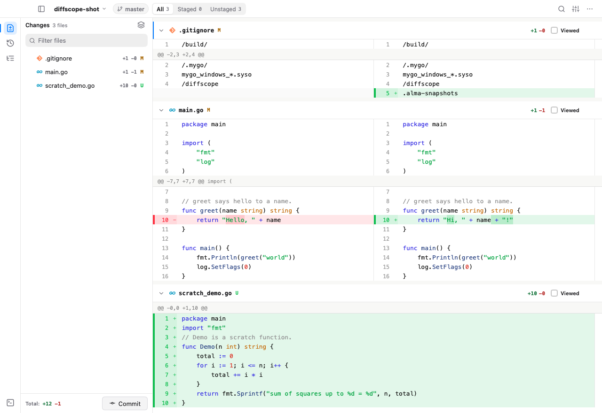

# Diffscope

A native, minimal, local diff viewer for reviewing Git changes and committing
them, in Go with [MyGo](https://mygo.egoist.dev/)'s native UI. No webview, no
JavaScript: the window is drawn by MyGo on the GPU, with the system's fonts,
accent color, dark mode, menus and vibrancy.

[Website](https://volcanicll.github.io/Diffscope/) ·
[Download](https://github.com/volcanicll/Diffscope/releases)



## Features

- **Review local changes**: all, staged, or unstaged files against `HEAD`
  (the toolbar's All / Staged / Unstaged segments), in one scrolling surface
  of file cards with sticky headers.
- **Split and unified diffs** (View → Diff) with syntax highlighting
  (the Licht and Dunkel palettes), word-level change highlighting, and
  unchanged lines that expand 100 at a time or all at once. New and deleted
  files show in one column.
- **Viewed files**: marking a file viewed collapses it, and it opens again
  once it changes. Generated files (lockfiles, `*.min.js`, protobufs,
  snapshots, …) and dependency folders (`node_modules`, `vendor`, `dist`,
  …) start collapsed.
- **Review comments**: click a line (or press <kbd>J</kbd>/<kbd>K</kbd> and
  <kbd>Enter</kbd>) to comment on a hunk; copy every comment as Markdown,
  with the diff around it, for an agent or a colleague (<kbd>⌘⇧M</kbd>).
- **Commit** the files you choose, with a subject and a summary, from the
  Commit button under the sidebar. Other staged work stays staged.
- **History**: browse commits, review any of them against its first parent,
  or compare the work tree with where it branched off a branch — and switch
  the checked-out branch from the toolbar's branch chip.
- **Repository browser** (<kbd>⌘4</kbd>): the files of the work tree, with
  any file's contents in an overlay, an in-file find bar, and picture
  previews (images and SVG).
- **Terminal** (<kbd>⌃`</kbd>): a real shell in a pty, under the review or
  beside it (View → Terminal Position), with a tab per session
  (<kbd>⌃⇧`</kbd> opens another). Dragging the divider resizes the panel,
  and its content re-wraps to the new width; closing the last tab hides
  the panel. The panel's tab strip has a context menu for all of this too.
- **Pull requests**: list the open pull requests of the repository's GitHub remote
  (<kbd>⌘3</kbd>) and review any of them, open or not. Diffscope fetches its
  commits into your clone, so it reads as local changes do: highlighted,
  expandable, with pictures. Its files group by kind (code, tests, docs,
  config, dependencies, generated), each group with how much of it you
  viewed; review threads show under their lines, to reply to and resolve;
  comments go out alone or into your review, which you submit as a comment,
  an approval or a request for changes. A banner says when new commits are
  pushed.
- **AI review**: a coding agent installed on your machine — Claude Code,
  Codex, OpenCode or Pi — reviews the changes, a pull request's or your
  own: it summarizes them, groups the files by intent, and notes the lines
  that deserve attention. It runs read-only, with the agent's own sign-in,
  and its review is kept until you ask for another. Choose the agent and
  the model in the review's card, among those the agent lists; by default
  OpenCode reviews with the model it starts with itself. The card lists the
  notes, and the file tree marks the files with some: click one, or press
  <kbd>N</kbd> and <kbd>⇧N</kbd>, to go from note to note.
- **Find in diffs** (<kbd>⌘F</kbd>), a **file filter** (<kbd>⌘P</kbd>) and a
  **command bar** (<kbd>⌘K</kbd>).
- Image previews of changed pictures; a file tree with change counts and
  status letters; a banner when the work tree changes; a welcome screen
  with the recent repositories when what opens is not a repository.
- Sidebar navigation selects files, directories, commits and pull requests
  on pointer press, showing the new selection as the sidebar takes focus.
  Directory disclosure and button actions activate on release.
- **File icons** of each kind of file, in its color, drawn as the file tree
  of [@pierre/trees](https://www.npmjs.com/package/@pierre/trees) does.

## Usage

```sh
go run . [<commit> | <branch> | <pull request>] [<path>]
```

- `diffscope` reviews the uncommitted changes of the repository you are in.
- `diffscope HEAD~1` reviews a commit, against its first parent.
- `diffscope main` compares the work tree, committed or not, with where it
  branched off `main`.
- `diffscope --pr 123`, `diffscope owner/repo#123` or `diffscope
  https://github.com/owner/repo/pull/123` reviews a pull request of the
  repository's GitHub remote (`upstream`, else `origin`).
- `diffscope ../other-repo` opens another repository.

Every repository opens in a window of its own, except **File → Open
Folder…** (<kbd>⌘O</kbd>) from a review window, which asks whether the
folder opens there or in a new window; a folder dropped on a window opens
there. **Diffscope → Install Command Line Tool…** installs a `diffscope`
command that opens the app on the repository it runs in. Started from Finder
or the Dock, the app reopens the repository opened last, and **File → Open
Recent** lists the ten opened lately. **File → Open Commit…**
(<kbd>⌘⇧C</kbd>) reviews any commit by its hash.

### Keyboard

| Keys | |
|---|---|
| <kbd>⌘K</kbd> | Command bar |
| <kbd>⌘P</kbd> | Filter files |
| <kbd>⌘F</kbd> | Find in diffs |
| <kbd>J</kbd> / <kbd>K</kbd>, <kbd>^↓</kbd> / <kbd>^↑</kbd> | Next / previous hunk |
| <kbd>N</kbd> / <kbd>⇧N</kbd> | Next / previous AI note |
| <kbd>Enter</kbd> | Comment on the hunk chosen |
| <kbd>Esc</kbd> | Clear the selection, the file browser or the find |
| <kbd>⌘↩</kbd> | Add the comment; commit, in the commit view |
| <kbd>⌘⇧M</kbd> | Copy review comments as Markdown |
| <kbd>⌘⇧B</kbd> | Toggle the sidebar |
| <kbd>⌃`</kbd> / <kbd>⌃⇧`</kbd> | Toggle the terminal / open a terminal tab |
| <kbd>⌘1</kbd> / <kbd>⌘2</kbd> / <kbd>⌘3</kbd> / <kbd>⌘4</kbd> | Files / History / Pull requests / Repository |
| <kbd>⌘⇧I</kbd> | Review with AI |
| <kbd>⌘⇧Enter</kbd> | Commit… |
| <kbd>⌘O</kbd> | Open folder |
| <kbd>⌘⇧C</kbd> | Open commit… |
| <kbd>⌘⇧O</kbd> | Open the file in your editor |
| <kbd>⌥Z</kbd> | Toggle word wrap |
| <kbd>⌘R</kbd> | Refresh the changes |
| <kbd>⌘,</kbd> | Open the config file |
| <kbd>⌘+</kbd> / <kbd>⌘−</kbd> / <kbd>⌘0</kbd> | Code font size |
| <kbd>⇧?</kbd> | All the shortcuts |

## Configuration

Settings live in `~/.diffscope/diffscope.jsonc`
(**Diffscope → Open Config File…**, <kbd>⌘,</kbd>), and apply to open
windows as the file changes:

```jsonc
{
  "settings": {
    "codeFontFamily": "",          // e.g. "JetBrains Mono"; empty is SF Mono
    "codeFontSize": 13,
    "copyCommentsOnClose": false,  // copy the comments when a window closes
    "diffStyle": "split",          // or "unified"
    "editorCommand": "",           // e.g. "zed {file}:{line}"
    "githubToken": "",             // empty uses the GitHub CLI's (gh auth login)
    "aiAgent": "",                 // claude, codex, opencode or pi; empty is the first installed
    "aiModel": "",                 // e.g. "sonnet"; empty is the agent's default
    "reviewCommentsPrefix": "# Address these Review Comments",
    "sidebarPosition": "left",     // or "right"
    "terminalPosition": "bottom",  // or "right"
    "showWhitespace": false,
    "theme": "system",             // or "light", "dark"
    "wordWrap": false
  }
}
```

Files open in `$DIFFSCOPE_EDITOR` or `editorCommand` (`{file}`, `{line}` and
`{repo}` are replaced), else VS Code, else the app the system opens them
with.

Pull requests need no token to be read when they are public; to comment and
review, or to read private ones, sign in with the GitHub CLI (`gh auth
login`), or set `githubToken`, `$DIFFSCOPE_GITHUB_TOKEN`, `$GH_TOKEN` or
`$GITHUB_TOKEN`.

The window remembers, per repository inside `~/.diffscope`, which files
were marked viewed, the sidebar's width and whether it showed, and the
terminal's size and whether it showed.

## Development

```sh
go tool mygo dev          # the app, rebuilt as you edit
go test ./...             # including the views, run without a window
go tool mygo build        # Diffscope.app and a disk image in build/
go run ./tools/genicon    # render resources/icon.svg to the app icon
go run ./tools/genfileicons <@pierre/trees package>  # update the file icons
```

To release, push a tag: `git tag v0.1.0 && git push origin v0.1.0`. The
Release workflow tests, builds the universal app and its disk image, and
publishes them to a GitHub release, with the version of the tag.

`DIFFSCOPE_SNAPSHOTS=<dir> go test .` saves PNGs of the views the tests
drive, and `DIFFSCOPE_CAPTURE=<file.png>` makes the app save a picture of
its window once loaded, then quit. `DIFFSCOPE_DEBUG=1` logs every git
command with its duration, the frames that take more than 4 ms to build, and
whenever the main thread keeps work waiting over 30 ms.
`DIFFSCOPE_NAME=<name>` runs a build apart from the installed app, which
would otherwise take its windows. `DIFFSCOPE_CPUPROFILE=<file>` and
`DIFFSCOPE_STARTUP_PROFILE=<file>` write CPU profiles.

The landing page is `site/index.html`: one self-contained file, with no
build step. Open it in a browser, or serve `site/` to preview it at a
local address. Pushes that change `site/` deploy it to GitHub Pages
(https://volcanicll.github.io/Diffscope/) through
`.github/workflows/pages.yml`.

The code is in a few parts:

- `internal/git`: the repository through the `git` command: changes,
  history, branches, commits, generated files, file contents
  (`git cat-file --batch`).
- `internal/diff`: parsing patches, and word-level differences.
- `internal/highlight`: syntax highlighting with Chroma.
- `internal/github`: pull requests, through `gh` or a token.
- `internal/agent`: the coding agents' review, with their models.
- `internal/fileicon`: the file tree's icons.
- `internal/vt`: the terminal emulator, adapted from `charmbracelet/x/vt`,
  with the reflow that re-wraps the screen and scrollback when the panel's
  width changes. `internal/shellenv` gives the shell the login environment
  the app found; the session ends the shell's process group itself.
- The `main` package: the window and its views (`view.go`, `sidebar.go`,
  `diffview.go`, `browse.go`, `commit.go`, `palette.go`, `terminal.go`),
  the rows of the diff surface (`rows.go`), the file kinds (`groups.go`),
  AI analysis (`analysis.go`), comments, find, settings and menus.

See [ARCHITECTURE.md](ARCHITECTURE.md) for how a review travels from a `git`
command to the screen.

## Not (yet) implemented

LLM walkthroughs, GitHub and GitLab pull request review beyond GitHub,
Markdown previews, editing files in place, definition lookup, `a..b`
ranges, and separate cards for the staged and unstaged parts of a file
(Diffscope shows a file's changes against `HEAD` as one; the toolbar's
All / Staged / Unstaged segments switch between them).
